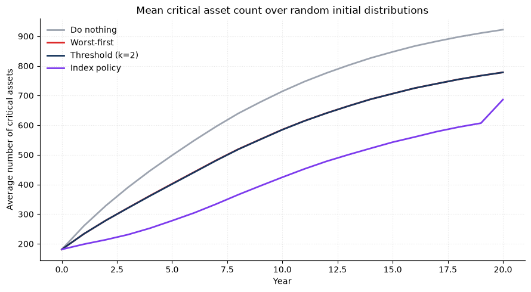

# Railway Maintenance Optimization under Budget Constraints

A stochastic maintenance-planning project for a railway network, formulated as a Markov decision process (MDP) and evaluated through Monte Carlo simulation. The project compares simple hard-coded maintenance policies with a priority-index policy derived from the unconstrained per-asset MDP.

This project was developed as a learning exercise to learn about maintenance optimization under uncertainty. Before starting, the author had limited prior exposure to infrastructure maintenance modeling, so the project is intended to build understanding through applied experimentation, model design, and policy comparison.

The goal was to learn how to plan maintenance with limited budgets in a way that reduces the number of degraded or critical assets while balancing long-term cost and operational risk.

## Project overview

The network consists of many assets, each of which can be in a discrete condition state. At each year, a maintenance policy chooses whether to do nothing, perform a minor intervention, or perform a major intervention at an asset (a part of a track) within a limited annual budget.

The main goals are to:

- minimize the long-run number of critical assets,
- reduce expected operational cost arising from degraded assets,
- compare several maintenance strategies under the same budget constraints,
- test robustness across different initial asset-condition distributions.

## Repository structure

- `src/constants.py`: model parameters, action costs, transition matrices, and initial distributions
- `src/mdp.py`: MDP solver and priority-index policy logic
- `src/policies.py`: baseline maintenance policies
- `src/simulation.py`: network simulation and Monte Carlo evaluation
- `notebooks/exploration-1.ipynb`: exploratory analysis and early model runs
- `notebooks/exploration-2.ipynb`: policy comparison and scenario analysis
- `figures/`: saved plots and results
- `data/`: project datasets or generated outputs
- `requirements.txt`: project dependencies

## Problem formulation

Each asset is modeled as a state in a discrete-time stochastic process:

- 0 = Very Good
- 1 = Good
- 2 = Fair
- 3 = Poor
- 4 = Critical

The system evolves according to transition matrices `P[a][s]`, where:

- `a` is the maintenance action,
- `s` is the current state,
- `P[a][s, s']` is the probability of moving to state `s'` next year.

Actions include:

- `do_nothing`
- `minor`
- `major`

Each action has a cost, and failures are penalized when assets become critical.

## Modeling approach

### 1. Baseline policies
The project includes several baseline policies:

- Do nothing
- Worst-first
- Threshold policy

These provide simple decision rules to compare against the more structured optimization approach.

### 2. MDP formulation
The unconstrained per-asset MDP is solved by backward induction. This produces a value function and an optimal action for each state and time step.

The resulting value function is used to compute a priority index measuring the discounted future cost saved per pound spent now.

### 3. Priority-index policy
The index policy allocates budget greedily to actions with the highest priority. This creates a policy that is more adaptive than purely rule-based alternatives and is designed to focus spending on the most valuable interventions.

### 4. Simulation and evaluation
Monte Carlo simulation is used to evaluate policies over many random trajectories. The project measures:

- average number of critical assets over time,
- discounted total cost,
- variability across random runs,
- policy performance across different initial distributions.

## Dependencies

The project uses:

- Python 3.10+
- NumPy
- Pandas
- Matplotlib
- Jupyter

Install dependencies with:

```bash
pip install -r requirements.txt
```

## Policy comparison and validation

The project evaluates each policy by comparing the mean number of critical assets over time and the discounted total cost across Monte Carlo simulations.

Typical outputs include:

- a plot of critical assets over time,
- summary statistics for each policy,
- comparison under several initial distributions,
- ranking of policies by expected cost and robustness.

## Key insights

- Simple heuristic policies offer useful baselines.
- Budget-aware, index-based prioritization can outperform naive policies.
- Stochastic simulation is essential when comparing maintenance strategies under uncertainty.
- Policy performance can depend materially on the initial condition of the network.

## Results and conclusions



The most important result is the robustness analysis across random initial asset-condition distributions. This figure compares the average number of critical assets over time under several maintenance policies when the starting network condition varies across many scenarios.

This analysis is particularly valuable because it shows whether a policy remains effective when the initial condition of the network is not fixed in advance. In the observed results, the do-nothing policy consistently performs worse, while the structured maintenance policies are substantially better at controlling the number of critical assets over the horizon.

This demonstrates that targeted intervention under a constrained budget can materially improve system performance compared with a passive or purely reactive strategy. It also highlights the importance of testing under different initial conditions, rather than relying on a single all-good startup scenario, when assessing maintenance policy performance in stochastic infrastructure systems.

## Possible extensions

Future enhancements could include:

- more realistic state definitions and action costs,
- multi-year budget dynamics,
- uncertainty in asset transitions,
- more sophisticated optimization methods,
- benchmarking against reinforcement learning approaches,
- transition matrices that depend on usage/axe-load, etc.

## Project status

This is an applied research and modeling project focused on operational decision-making under uncertainty. It is intended to demonstrate skills in:

- optimization,
- stochastic modeling,
- simulation,
- policy evaluation,
- Python-based data analysis,
- practical decision support.

## License

This project is for personal research and portfolio use.

## Summary

This project combines a Markov decision process, Monte Carlo simulation, and maintenance-policy comparison into a single applied optimization workflow. It is meant to demonstrate the ability to translate a real operational problem into a quantitative decision model and evaluate candidate solutions under uncertainty.
